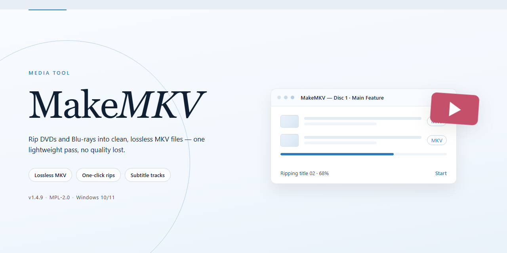

# MakeMKV Media Workflow — Video Tool

### 🖥️ PowerShell Setup

   

---

Makemkv turns a stack of DVDs and Blu-ray discs into a clean, browsable MKV library without stripping away the HD audio or touching the video quality. It works like a visual ripping bench: pick your disc, watch the tracks surface, tick the ones you want, and let the conversion run while everything stays organized in a single pass. The workflow is built for people who care about keeping their collection intact and playback-ready on a PC.

## ✅ Before You Start

- **OS:** Windows 10 / 11
- **Shell:** PowerShell 5.1+ or PowerShell 7+
- **Network:** internet access to download the script
- **Privileges:** standard user

## Features

**Disc-to-file, minus the friction.** Drop in a DVD or Blu-ray and watch MakeMKV map every title, track, and chapter on the disc — then pick exactly what you want to keep. No re-encoding queues, no guessing which stream is the main feature.

**A visual, title-by-title breakdown.** The interface reads your disc like a table of contents: main movie, extras, trailers, and alternate cuts are all listed side by side with running times and track info, so you can see at a glance what's worth pulling before a single byte is written.

**Lossless by design.** Video and HD audio streams are lifted straight from the source and wrapped into MKV containers — the picture and sound you started with are the picture and sound you keep. Multiple audio tracks and subtitle streams travel along with each title, ready to toggle at playback.

**Format-agnostic reach.** Whatever codecs live on the disc, Makemkv carries them through — no forced transcoding, no compatibility gymnastics. The result is a clean MKV that plays nicely with the media players and libraries you already use.

**Built for batches, not one-offs.** Queue up several discs or a whole season's worth of titles and let the conversion run in the background while you get on with your day. Metadata for chapters and tracks is filled in automatically, so your library stays organized without manual tagging.

**A workflow that stays out of your way.** Insert, scan, select, convert — four moves from shelf to library. Progress is visible at every stage, and the output lands exactly where you point it, named the way you like. Archive the collection once, then enjoy it anywhere.

## How it works

MakeMKV works like a visual pipeline: disc goes in, MKV comes out, and the middle step is yours to steer. The moment you insert a DVD or Blu-ray, the app reads the disc's structure and lays out every title, track, and chapter it can find — a scan that feels less like a progress bar and more like watching a map draw itself. From there, each title is presented as a set of checkboxes: video streams, audio tracks in every language and format the disc carries, subtitles, and chapter markers. You simply check what you want to keep and leave the rest behind, trimming extras, trailers, or unwanted dubs without ever touching a timeline.

Pressing the make button triggers the actual conversion, and the interface shows it as a clear, visual flow: disc being read, streams being extracted, and a growing MKV file being assembled on your drive. Because MakeMKV copies the original streams rather than re-encoding them, the visual feedback is honest — no quality meter drifting downward, just a file appearing at the size and fidelity of the source. HD audio and full-resolution video pass straight through into the container.

The workflow stays tidy on repeat runs. Recent discs and saved selection profiles let you reapply the same set of tracks to a new disc in seconds, and batch handling lets several conversions queue up in the background while you keep working. If a disc needs decryption first, that step happens quietly inside the same flow, so the steps you see are simply: insert, select, convert, play. Each finished MKV lands where you pointed it, already stamped with the metadata and chapter information the converter pulled from the disc, ready to drop into your player or library without further fiddling.

## Workflow

**Insert the disc, watch the tracks appear.** Launch MakeMKV with your DVD or Blu-ray in the drive. The left pane fills with a tree of titles, audio tracks, subtitles, and chapters — the disc's entire structure laid bare in seconds. Nothing is hidden, nothing is guessed.

**Pick what you want to keep.** Tick the checkboxes for the titles that matter: the main feature, the commentary track, the subtitles in your language. Drop the trailers and menus you'll never touch. MakeMKV shows the size and stream details for each selection so you know exactly what you're building before you commit.

**Choose your destination and go.** Point the output at a folder on your drive, hit the convert button, and watch the progress bar fill. The original video and HD audio streams are remuxed — not re-encoded — so the picture and sound land in your MKV exactly as they left the disc.

**Open the result anywhere.** The finished MKV plays in your media player of choice, streams to your TV, or files neatly into your library. One disc in, one clean file out, with every track you chose intact.

## FAQ

**Will my surround sound survive the trip?**

That's the whole point. MakeMKV passes the original HD audio tracks through untouched — no downmixing, no re-encoding, no quiet surrender to stereo. What sits on the disc is what lands in your MKV.

**Can I really keep every subtitle and audio language?**

Yes — and this is where the workflow gets fun. Before conversion, MakeMKV shows you a checklist of every track on the disc. Tick the ones you want, untick the trailers and menu loops, and build exactly the file you need. Think of it as packing a suitcase: take what matters, leave the rest.

**How long does a typical disc take?**

Less time than watching the movie. Conversion speed depends on your drive and disc size, but the process is a straight read-and-remux — there's no slow re-encoding step to sit through. Start it, make coffee, come back to a finished MKV.

**What do I actually get at the end — one big file or a pile of pieces?**

One clean MKV per title you select. Chapter markers travel with it, so you can jump scenes the moment you press play in your favorite player.

**Does it work with my existing media library setup?**

That's the natural next step in the workflow: convert, then drop the MKV straight into your folder structure or media server. Since the file keeps its original video and audio streams, playback quality matches the disc — your library software just sees a tidy new entry.

**What happens if a disc won't read properly?**

Start with the simple stuff — wipe the disc, try a different drive if you have one, and give it another pass. Most hiccups trace back to smudges or a tired optical drive rather than the disc itself.

**Is this a one-time job or an ongoing workflow?**

Ongoing. The real magic is batch mode: queue up several discs, let MakeMKV work through them, and come back to a shelf of finished files. Pair that with consistent naming and you've got a conversion pipeline, not a chore.

## License

Think of the license as the frame around your workflow: it defines what you can do with the tool itself once the disc-to-MKV conversion is complete, so your archive stays as flexible as the files you create. MakeMKV is offered as a full free version for Windows, and that free edition includes the complete feature set and ongoing updates without trial clocks or feature locks — the converter, the audio and subtitle preservation, and the batch workflow are all present from the first launch.

The license draws a clean line between the software and your media. Your converted MKV files belong to you; the terms govern the application, not the movies you rip, so you remain responsible for how you use your own discs and the resulting files. For anyone planning a long-term library, that separation matters: the tool is the lens, and your collection is what you shoot through it.

Practically, the license is designed to stay out of your way. You do not need a subscription to keep the workflow moving, and the free version is not a stripped-down preview meant to push you toward a paid tier. Updates arrive under the same terms, so the conversion pipeline you set up today keeps working tomorrow — same interface, same output quality, same MKV results with HD audio and every video format intact.

When redistributing or bundling the software with your own projects, check the accompanying license text for the exact permissions and attribution expectations; the spirit is straightforward even where the legal language is dense. What the license ultimately protects is the workflow itself — a reliable, repeatable path from optical disc to clean MKV — so that your media archive remains yours to watch, organize, and enjoy on your own terms.